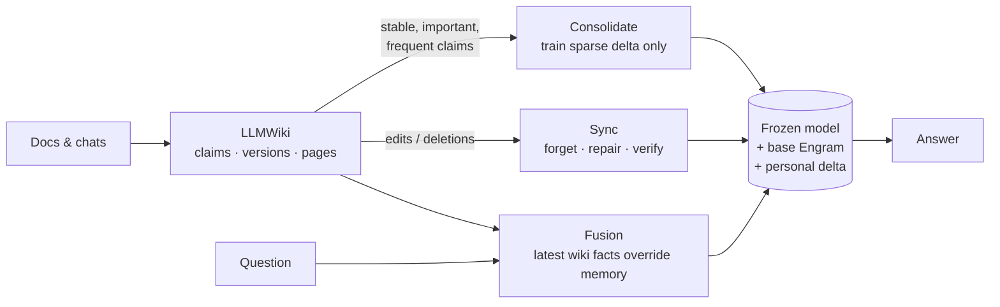

<div align="center">

# WikiEngram

**Train Memory, Not Your LLM.**

Consolidate an LLM-maintained wiki into the **Engram** conditional memory of MoE models, while the model stays frozen.

[](https://github.com/Zihao-Wu06/WikiEngram/actions/workflows/ci.yml)
[](LICENSE)


</div>

WikiEngram gives a language model two memories, modelled on how people consolidate memories:

* **LLMWiki (explicit memory).** Knowledge is extracted from your documents and conversations into a
  versioned, human-readable wiki, following Karpathy's "LLM Wiki" pattern. Corrections and deletions are
  instant, and every version is kept.
* **Engram (neural memory).** Knowledge that is stable, important and frequently used is *consolidated* into
  a small, sparse, personal delta over the model's [Engram](https://github.com/deepseek-ai/Engram) tables
  (hashed n-gram embedding memory). After that the model answers from its weights, with no context tokens.

WikiEngram is built for **MoE models that carry an Engram-style conditional memory**, not for one vendor. The
personal-memory machinery talks to a small `EngramVariant` interface (row addressing, row grouping, fusion
module), and each Engram family implements it once. DeepSeek's Engram (DeepSeek-V4.1-Flash) is the first
variant, ported bit-exactly; see [supported models](#supported-engram-models).

The backbone is never updated. Neither are the base Engram tables or the Engram fusion layer: only the sparse
delta rows are trained, and byte-exact checksums of all three are compared before and after every training
run. When a wiki fact is corrected or deleted, the rows only that fact wrote are removed from the delta, so
they read the frozen base table again, bit for bit. Rows it shared with other facts are reset and retrained for
those facts. Engram-only probes then verify that the old answer is gone.



## Status

What is implemented and tested, and what is not:

| | Status |
|---|---|
| Model-agnostic core: `EngramVariant` interface + registry; personal memory, consolidation, sync and fusion use only the interface | ✅ ([toy-family test](tests/test_variants.py)) |
| DeepSeek Engram variant, ported from DeepSeek-V4.1-Flash (tokenizer compression, prime bucket layout, multi-head n-gram hashing, gated fusion) | ✅ bit-exact against the official code ([tests](tests/test_engram_parity.py)) |
| Native V4.1 FP8 Engram table reader (`F8_E4M3` + `E8M0` scales from the official shards) | ✅ tested on synthetic shards |
| Personal sparse delta: row-sparse lazy-Adam training, save/load, versions, rollback, exact deletion | ✅ |
| Retrofit backend: frozen Hugging Face decoder (Qwen3, SmolLM2, Llama-style) + an Engram variant | ✅ runs on CUDA, Apple MPS, CPU |
| LLMWiki: extraction (rule-based or any OpenAI-compatible LLM), reconciliation, versioning, lint, markdown pages | ✅ |
| Consolidation policy, sync of edits and deletions, dual-memory fusion, CLI, HTTP API, Docker | ✅ |
| Benchmark: LLMWiki-only vs Engram-only vs LLMWiki + Engram | ✅ real runs (numbers below) |
| **Native Engram MoE backbones** (DeepSeek-V4.1-Flash first: 552B + 196B Engram) training and inference | 🚧 planned: [docs/NATIVE_MOE.md](docs/NATIVE_MOE.md) |

**Why a retrofit backend?** The models that ship Engram natively are large MoE models (DeepSeek-V4.1-Flash is
about 510 GB). To run anywhere today, WikiEngram attaches the *same* Engram variant to a small frozen decoder.
The base Engram is trained once with the backbone frozen (`wikiengram adapt`) and then frozen too, mirroring
the native "frozen MoE backbone + pretrained Engram" setting. Everything except the backbone and the table
reader is shared with the planned native backends.

## Supported Engram models

| Model / family | Engram variant | What works today |
|---|---|---|
| Any Hugging Face decoder (retrofit) | `deepseek-v4.1` (default) or `qwen-ple` | ✅ full pipeline: adapt, consolidate, sync, ask, benchmark |
| **DeepSeek-V4.1-Flash** / -1017 (MoE, native Engram) | `deepseek-v4.1` | ✅ hashing, layout, compression and fusion bit-exact vs official code; native FP8 table reader; config detection. 🚧 native backbone training and inference |
| **Qwen3.8-Flash-Next** (MoE, native "PLE" n-gram memory) | `qwen-ple` | ✅ hashing (incl. the real checkpoint's constants) and fusion with its dilated conv, bit-exact vs the transformers reference in fp32 and bf16; config detection. 🚧 sharded table reader, native backbone training and inference |

Meituan's LongCat models use a different design: a hashed n-gram embedding added at the input, with no gated
Engram module. They are not supported.

Pick the family for a retrofit backbone in `wikiengram.toml`: `[engram] variant = "qwen-ple"`.

Adding a family means implementing one `EngramVariant` (`src/wikiengram/engram/variant.py`), with parity tests
against that family's reference code. [docs/NATIVE_MOE.md](docs/NATIVE_MOE.md) lists what a native backend
needs and the status of each family.

## Quick start

```bash
pip install -e ".[api,data]"          # Python 3.10+, PyTorch 2.4+
```

```bash
wikiengram init --model Qwen/Qwen3-0.6B-Base
```

```bash
wikiengram adapt --steps 300          # once per backbone: train the base Engram, backbone frozen
```

```bash
wikiengram ingest examples/data/team_notes.md
```

```bash
wikiengram ingest --kind conversation examples/data/conversation.json
```

```bash
wikiengram consolidate --plan         # what would be trained, and an estimate
```

```bash
wikiengram consolidate                # train selected claims into the personal Engram delta
```

```bash
wikiengram ask --mode hybrid "Where does Ilsa Varrow work?"
```

Correct a fact. Engram forgets the old value and the wiki answers the new one right away:

```bash
wikiengram wiki correct <claim-id> --object "Northgate Systems"
```

```bash
wikiengram sync
```

[`examples/quickstart.sh`](examples/quickstart.sh) runs the whole flow and
[`examples/python_api.py`](examples/python_api.py) shows the Python API. For the HTTP API:

```bash
wikiengram serve --port 8765          # OpenAPI docs at http://127.0.0.1:8765/docs
```

```bash
docker compose up --build             # CUDA image; docker/Dockerfile is the CPU image
```

### Memory modes

| Mode | What answers |
|---|---|
| `none` | the frozen backbone alone |
| `wiki` | LLMWiki only: retrieved claims in the prompt (BM25 + entity match, no vector index) |
| `engram` | neural memory only: base Engram + personal delta, no context |
| `hybrid` | both, routed per question: if Engram verifiably recalls the most relevant claim at its current version, that claim is left out of the prompt and the personal delta answers; otherwise the wiki answers and the delta stays off, so new, edited or unverified knowledge always comes from the latest wiki state |

## Benchmark

<!-- BENCHMARK:START -->
Measured on an **Apple M4 (32 GB, MPS)** with **Qwen3-0.6B-Base**, 50 fictitious facts, single run (seed 0).
The base Engram was trained once for 300 steps on WikiText-2 with the backbone frozen; held-out perplexity
went from 27.5 to 23.4.

| Memory | Trained question | Held-out paraphrase | Prompt tokens / query | Time to first token | Total (batch 1) |
|---|---|---|---|---|---|
| Backbone only (no memory) | 0% | 0% | 18 | 46 ms | 408 ms |
| LLMWiki only | 100% | 98% | 87 | 88 ms | 211 ms |
| Engram only | 96% | 56% | 18 | 52 ms | 166 ms |
| **LLMWiki + Engram** | 100% | 94% | 62 | 54 ms | 194 ms |

| After correcting 10 facts and deleting 5 in the wiki, then `sync` | Engram only | LLMWiki + Engram |
|---|---|---|
| Corrected facts: new value answered | 0% (not consolidated yet) | 100% |
| Corrected facts: old value still produced (lower is better) | 0% | 0% |
| Deleted facts still produced (lower is better) | 0% | 0% |
| Untouched facts retained | 100% | 100% |
| After re-consolidating the corrected facts: new value / untouched retained | 100% / 100% | |

What the numbers say:

* **Engram costs no prompt tokens.** It answers trained questions at 96% with the
  same prompt as no memory at all, and almost the same time to first token (52 ms vs
  46 ms). LLMWiki needs 87 prompt tokens and 88 ms.
* **Engram alone generalizes only partly to unseen wordings** (56%): n-gram memory
  is keyed on surface tokens.
* **The hybrid keeps the wiki's accuracy at a lower cost.** It answers 100% /
  94%, with 28% fewer prompt tokens and 39% lower
  time to first token than LLMWiki alone. 34% of questions were routed to Engram: the claims that passed verification.
* **Updates take effect immediately.** After `sync`, corrected and deleted values are never produced again,
  and corrected values come from the wiki right away. Re-consolidating teaches Engram the new values without
  losing untouched facts.
* **The cost is small.** Consolidating 50 facts took 116 s on the M4, and the personal delta is a
  33 MB file. The backbone, base Engram and fusion parameters are byte-for-byte unchanged.

Caveats:
* The scale is small: 50 facts, one seed, a 0.6B model.
* On MPS, peak memory is the driver's allocation (an upper bound); see the raw data.
* Larger runs (Qwen3-1.7B, more facts, CUDA) and native Engram MoE backends are not measured yet.

Raw data: [`benchmarks/results/m4-qwen3-0.6b-50facts.json`](benchmarks/results/m4-qwen3-0.6b-50facts.json).
<!-- BENCHMARK:END -->

To reproduce:

```bash
wikiengram bench --facts 50 --model Qwen/Qwen3-0.6B-Base --out benchmark-results
```

The facts are fictitious (invented names, companies and towns), so the base model cannot know them. Held-out
paraphrases are never used in training or verification. Every number comes from real training and generation
on the stated hardware.

## How it works

* **Any Engram family, faithfully.** The core only needs a variant's row addressing, row grouping and fusion
  module. The DeepSeek variant ports compression, hashing, prime layout, gating and V4.1's native FP8 table
  format from DeepSeek-V4.1-Flash's MIT-licensed inference code, checked bit for bit
  ([docs/ARCHITECTURE.md](docs/ARCHITECTURE.md)).
* **Sparse by construction.** Rows are addressed by token ids, so the rows a fact touches are known before the
  forward pass. Training updates only those rows with lazy Adam, and its cost does not depend on table size.
  The base table can live in RAM or on SSD.
* **Exact, verified forgetting.** A fact-to-row ledger records every row each claim's training wrote. Deleting
  a claim removes its exclusive rows (they read as the frozen base again, bit for bit). Rows it shared with
  surviving claims are reset; survivors whose recall probes now fail are retrained on those rows and their own.
  Engram-only probes verify that the old answer is gone, and purging a claim also deletes old memory
  snapshots that contained it.
* **Automatic consolidation.** A policy scores claims on importance, usage frequency, stability (age of the
  current version, minus edits) and confidence, with a minimum confidence and a stability window. Pinned
  claims go first.
* **Dual-memory inference.** Each question is routed to the memory that verifiably holds the answer. The
  personal delta acts on the question tokens only, never on wiki context in the prompt. Pending wiki edits are
  applied to memory instantly before answering (rows masked, no training needed), so stale memory never
  answers.

## Hardware

| Task | Apple M4, 32 GB (MPS) | Single NVIDIA GPU |
|---|---|---|
| Retrofit backend, Qwen3-0.6B: adapt (300 steps), consolidate, ask | ✅ measured below | expected ✅, not yet benchmarked |
| Retrofit backend, Qwen3-1.7B | runs (about 2× slower to train), not yet benchmarked | expected ✅, not yet benchmarked |
| Native Engram MoE (e.g. DeepSeek-V4.1-Flash) | ✗ | 🚧 planned: one RTX 5090 + 90 GB RAM + NVMe, streaming trainer ([estimates](docs/NATIVE_MOE.md)) |

## Project layout

```
src/wikiengram/
  engram/          variant interface + registry; DeepSeek variant (compression, layout, hashing, fusion);
                   tables (incl. FP8), personal delta, row-sparse optimizer, stage-1 adapt
  backends/hf.py   frozen Hugging Face decoder + Engram hooks, KV-cached generation with exact n-gram history
  wiki/            LLMWiki: extraction, reconciliation, claim store (versions/events), BM25 retrieval, pages
  consolidation/   policy, samples, delta trainer, row ledger, background row statistics, verification
  sync/            propagate wiki edits/deletions into memory (forget, repair, verify)
  fusion/          dual-memory inference
  runtime.py       the workspace facade used by the CLI and the API
  cli.py, api/     command line and FastAPI server
  bench/           synthetic facts and the benchmark runner
tests/             parity tests against DeepSeek's reference code, unit and end-to-end tests
```

## Limitations

* N-gram memory is keyed on surface tokens. Paraphrases that share the entity's tokens are recalled better
  than very different wordings. The benchmark reports held-out paraphrase accuracy separately.
* Knowledge the frozen backbone already has cannot be erased by deleting delta rows. The wiki overrides it at
  answer time.
* A retrofitted Engram is not the same as Engram pretrained jointly with the backbone. Native MoE backends are
  the next milestone.

## Acknowledgements

* DeepSeek-AI: Engram ([paper](https://arxiv.org/abs/2601.07372), [demo](https://github.com/deepseek-ai/Engram), Apache-2.0) and
  [DeepSeek-V4.1-Flash](https://huggingface.co/deepseek-ai/DeepSeek-V4.1-Flash) (MIT), whose inference code
  the Engram port follows.
* Andrej Karpathy's [LLM Wiki](https://gist.github.com/karpathy/442a6bf555914893e9891c11519de94f) pattern.
* [Strata](https://github.com/Niko1221/Strata) for showing V4.1 runs on consumer hardware.

```bibtex
@article{cheng2026engram,
  title   = {Conditional Memory via Scalable Lookup: A New Axis of Sparsity for Large Language Models},
  author  = {Cheng, Xin and Zeng, Wangding and Dai, Damai and others},
  journal = {arXiv preprint arXiv:2601.07372},
  year    = {2026}
}
```

## License

Apache-2.0. See [LICENSE](LICENSE) and [NOTICE](NOTICE) for third-party notices.
