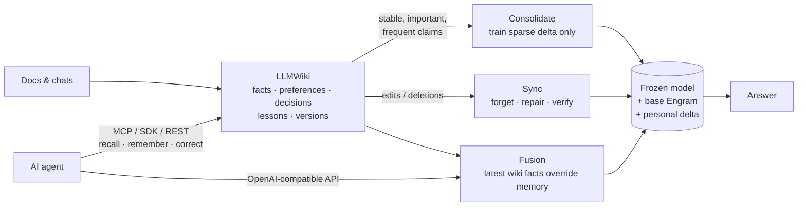

<div align="center">

# WikiEngram

**Train Memory, Not Your LLM.**

Open-source long-term memory for LLMs and AI agents: an LLM-maintained wiki, consolidated into the **Engram**
memory of open MoE models while the model stays frozen.

[](https://github.com/Zihao-Wu06/WikiEngram/actions/workflows/ci.yml)
[](LICENSE)


</div>

WikiEngram gives language models and AI agents persistent, personal memory that keeps learning. It has two
memories, modelled on how people consolidate what they learn:

* **LLMWiki (explicit memory).** Knowledge from conversations, documents, project material and the experience
  agents gain while doing tasks is extracted, organised, linked and kept up to date in a versioned,
  human-readable wiki (Karpathy's "LLM Wiki" pattern). It can be searched, edited and corrected; corrections
  and deletions are instant and every version is kept.
* **Engram (neural memory).** Knowledge that is stable, important and frequently used is *consolidated* by
  sparse incremental training into a small personal delta over the model's
  [Engram](https://github.com/deepseek-ai/Engram) tables (hashed n-gram embedding memory). The model's own
  parameters are never changed. After that the model answers from memory, with no context tokens.

At inference the two are combined: live wiki retrieval for what is new or not yet verified, Engram recall for
what has been consolidated. The aim is less repeated retrieval, fewer context tokens and cheap memory updates.

**For AI agents.** Agents connect through an OpenAI-compatible model API, a Python SDK, a REST API and MCP, for
memory across sessions, user preferences, project context, reuse of past decisions and lessons from earlier
tasks ([details](#use-it-from-ai-agents)). Neural memory needs an Engram-compatible model; any other model uses
the same memory through wiki retrieval. The goal is AI that stops re-reading its knowledge every time and
instead accumulates, updates and uses long-term memory.

WikiEngram is built for **MoE models that carry an Engram-style conditional memory**, not for one vendor. The
personal-memory machinery talks to a small `EngramVariant` interface (row addressing, row grouping, fusion
module), and each Engram family implements it once. DeepSeek's Engram (DeepSeek-V4.1-Flash) is the first
variant, ported bit-exactly; see [supported models](#supported-engram-models).

The backbone is never updated. Neither are the base Engram tables or the Engram fusion layer: only the sparse
delta rows are trained, and byte-exact checksums of all three are compared before and after every training
run. When a wiki fact is corrected or deleted, the rows only that fact wrote are removed from the delta, so
they read the frozen base table again, bit for bit. Rows it shared with other facts are reset and retrained for
those facts. Engram-only probes then verify that the old answer is gone.



## Results: a real project's memory in Qwen3.8-Flash-Next

The finished example turns the documentation of **[Strata](https://github.com/Niko1221/Strata)** (MIT), an
open-source engine that runs large MoE models on consumer PCs, into long-term memory for
**Qwen3.8-Flash-Next**, and serves it to an AI agent ([`examples/strata/`](examples/strata/)). Everything was
measured on **one RTX 5090 (32 GB)** in a container with 25 CPU cores and a 92 GB memory limit. The model runs
straight from its 173 GB FP8 release.

**The memory.** A local Qwen3-4B-Instruct-2507 extracted 326 claims from 8 of Strata's documents. Review
against the documents removed 197 (markup, tautologies, duplicates, facts that lost their context), rewrote
129 to be precise and self-contained, and added 20 that the extractor missed. Every decision is in
[`review.json`](examples/strata/review.json). The 4B model then wrote 5–6 phrasings per fact: 4 are trained
(each also as a plain chat message), and 1 is held out and never trained. **149 facts** were consolidated.

**Recall.** Each fact is asked once with a trained phrasing and once with its held-out phrasing. Greedy
decoding; an answer counts when it appears in the reply as whole words (Markdown marks ignored).

| Answered by | Trained phrasing | Held-out phrasing | Prompt tokens |
|---|---|---|---|
| Qwen3.8-Flash-Next as shipped | 4.0% | 5.4% | 35 |
| **Engram only** ("Question: … Answer:") | **99.3%** | 42.3% | 35 |
| **Engram only**, plain chat message (what an agent sends) | **99.3%** | 34.9% | 30 |
| LLMWiki only (top 5 facts in the prompt) | 90.6% | 89.3% | 174 |
| **LLMWiki + Engram** | **91.9%** | **91.3%** | **121** |

* **Engram recalls what it was taught, with no context at all:** 148 of 149 facts, asked the way they were
  trained, from a 30–35 token prompt.
* **New wordings are its weak spot** (35–42%), and a miss can be off-topic rather than "I don't know". So the
  hybrid hands a question to Engram only when Engram has verifiably learned the fact (59 of 149 facts pass
  every probe, including a held-out phrasing); everything else is answered from the wiki.
* **Together they are the best all-round:** 91.9% / 91.3%, above LLMWiki alone on both and far above Engram
  alone on new wordings, with 30% fewer prompt tokens than LLMWiki: 40% of questions are answered by Engram with
  nothing retrieved into the prompt. On trained wordings Engram alone stays ahead (99.3%), because the hybrid
  sends facts that Engram has not verifiably learned to the wiki.

| Cost and side effects | |
|---|---|
| Consolidation | 25 epochs (stopped at the loss target), 2 h 6 min; peak 28.8 GiB of GPU memory and 33.8 GiB of RAM |
| Verification after training | 99.2% of 596 trained-phrasing probes, 43.0% of held-out ones, 91.4% of statements |
| Personal memory | 93,339 delta rows (14.9 M parameters): a 61 MB file (180 MB with the optimizer state, for further training) |
| Frozen | the resident weights and the fusion layers are checksum-identical before and after; experts and the n-gram table are only read from the release files |
| General text | wikitext-2 perplexity 12.43 without the memory, 12.46 with it (+0.25%) |

**Through the model API.** Eight questions written for the demo, in wordings never trained, sent as plain chat
messages to `wikiengram serve-model` ([transcript](examples/strata/results/transcript.md)): Qwen3.8 as shipped
answered none (it invented `localhost:8080`, `strata status`, `speed_test`). With its memory and nothing in the
prompt it answered 4: `SSD`, `STRATA_KV_PREFETCH=1` and `strata_benchmark` as the whole reply, in 5–9 s
against about 40 s for the shipped model's long wrong answers, and "580 or newer" in a sentence. Its four
misses were off-topic, which is why agents should use the hybrid mode or the MCP memory tools for anything not
yet verified. The API's hybrid mode, which adds unverified wiki facts to the prompt, also answered 4, two of
them from the wiki (`24,576` experts, `strata launch --status`).

**As an agent.** Given the LLMWiki memory tools over MCP and the task "I want to run Qwen3.8-Flash-Next with
Strata on a PC with a 16 GB graphics card. Check our project memory first, then tell me where the model's parts
will live. Afterwards record the decision", Qwen3.8 (through the model API, with its memory) called
`memory_context`, then `memory_recall` three times, recorded the decision with `memory_record_decision`, and
answered from what it had recalled: 24,576 experts with about 10 active per word, about 700 more experts per
extra GB of VRAM, the rest in system RAM. The answer was cut off at 256 tokens and is not flawless (it presents
the experimental disjoint expert cache as standard); the full exchange is in the
[transcript](examples/strata/results/transcript.md).

Raw data: [`examples/strata/results/`](examples/strata/results/): every question and answer, the training log,
GPU and RAM samples. The trained memory is in [`examples/strata/memory/`](examples/strata/memory/) (the 61 MB
delta file is not in git; [rebuild it](examples/strata/README.md#reproduce)).

## Status

What is implemented and tested, and what is not:

| | Status |
|---|---|
| Model-agnostic core: `EngramVariant` interface + registry; personal memory, consolidation, sync and fusion use only the interface | ✅ ([toy-family test](tests/test_variants.py)) |
| DeepSeek Engram variant, ported from DeepSeek-V4.1-Flash (tokenizer compression, prime bucket layout, multi-head n-gram hashing, gated fusion) | ✅ bit-exact against the official code ([tests](tests/test_engram_parity.py)) |
| Native V4.1 FP8 Engram table reader (`F8_E4M3` + `E8M0` scales from the official shards) | ✅ tested on synthetic shards |
| Personal sparse delta: row-sparse lazy-Adam training, save/load, versions, rollback, exact deletion | ✅ |
| Retrofit backend: frozen Hugging Face decoder (Qwen3, SmolLM2, Llama-style) + an Engram variant | ✅ runs on CUDA, Apple MPS, CPU |
| LLMWiki: extraction (rule-based or any OpenAI-compatible LLM), reconciliation, versioning, lint, markdown pages | ✅ |
| Consolidation policy, sync of edits and deletions, dual-memory fusion, CLI, HTTP API, Docker | ✅ |
| Benchmark: LLMWiki-only vs Engram-only vs LLMWiki + Engram | ✅ real runs (numbers below) |
| Agent integration: LLMWiki MCP server, OpenAI-compatible model API (streaming, tool calls), REST tools, Python SDK, function-calling schemas | ✅ ([tests](tests/test_agent.py), [model API tests](tests/test_model_api.py)) |
| Memory kinds and project scopes (facts, preferences, decisions, lessons, notes) | ✅ |
| **Qwen3.8-Flash-Next** (about 180B MoE, native PLE n-gram memory): runs and trains straight from its FP8 release on one RTX 5090 (streamed experts, sharded FP8 table reader, streamed backward) | ✅ measured, see [Results](#results-a-real-projects-memory-in-qwen38-flash-next) |
| Models larger than the GPU: accelerate placement + layer-by-layer recompute backward; CUDA, ROCm, Intel XPU, Apple MPS, CPU | ✅ (gradients equal ordinary back-propagation, [tests](tests/test_streaming.py)) |
| **DeepSeek-V4.1-Flash** native backbone (552B + 196B Engram) training and inference | 🚧 no trainable Hugging Face implementation yet: [docs/NATIVE_MOE.md](docs/NATIVE_MOE.md) |

**Why a retrofit backend?** The models that ship Engram natively are large MoE models (DeepSeek-V4.1-Flash is
about 510 GB). To run anywhere today, WikiEngram attaches the *same* Engram variant to a small frozen decoder.
The base Engram is trained once with the backbone frozen (`wikiengram adapt`) and then frozen too, mirroring
the native "frozen MoE backbone + pretrained Engram" setting. Everything except the backbone and the table
reader is shared with the native backends (Qwen3.8-Flash-Next runs natively today).

## Supported Engram models

| Model / family | Engram variant | What works today |
|---|---|---|
| Any Hugging Face decoder (retrofit) | `deepseek-v4.1` (default) or `qwen-ple` | ✅ full pipeline: adapt, consolidate, sync, ask, benchmark |
| **DeepSeek-V4.1-Flash** / -1017 (MoE, native Engram) | `deepseek-v4.1` | ✅ hashing, layout, compression and fusion bit-exact vs official code; native FP8 table reader; config detection. 🚧 native backbone training and inference |
| **Qwen3.8-Flash-Next** (MoE, native "PLE" n-gram memory) | `qwen-ple` | ✅ hashing (incl. the real checkpoint's constants) and fusion with its dilated conv, bit-exact vs the transformers reference in fp32 and bf16; config detection; runs and trains straight from the FP8 release on one 32 GB GPU (streamed experts, sharded FP8 table reader, streamed backward); [measured](#results-a-real-projects-memory-in-qwen38-flash-next) |

Meituan's LongCat models use a different design: a hashed n-gram embedding added at the input, with no gated
Engram module. They are not supported.

Pick the family for a retrofit backbone in `wikiengram.toml`: `[engram] variant = "qwen-ple"`.

Adding a family means implementing one `EngramVariant` (`src/wikiengram/engram/variant.py`), with parity tests
against that family's reference code. [docs/NATIVE_MOE.md](docs/NATIVE_MOE.md) lists what a native backend
needs and the status of each family.

## Quick start

```bash
pip install -e ".[api,data]"          # Python 3.10+, PyTorch 2.4+
```

```bash
wikiengram init --model Qwen/Qwen3-0.6B-Base
```

```bash
wikiengram adapt --steps 300          # once per backbone: train the base Engram, backbone frozen
```

```bash
wikiengram ingest examples/data/team_notes.md
```

```bash
wikiengram ingest --kind conversation examples/data/conversation.json
```

```bash
wikiengram consolidate --plan         # what would be trained, and an estimate
```

```bash
wikiengram consolidate                # train selected claims into the personal Engram delta
```

```bash
wikiengram ask --mode hybrid "Where does Ilsa Varrow work?"
```

Correct a fact. Engram forgets the old value and the wiki answers the new one right away:

```bash
wikiengram wiki correct <claim-id> --object "Northgate Systems"
```

```bash
wikiengram sync
```

[`examples/quickstart.sh`](examples/quickstart.sh) runs the whole flow and
[`examples/python_api.py`](examples/python_api.py) shows the Python API. For the HTTP API:

```bash
wikiengram serve --port 8765          # OpenAPI docs at http://127.0.0.1:8765/docs
```

```bash
docker compose up --build             # CUDA image; docker/Dockerfile is the CPU image
```

### Memory modes

| Mode | What answers |
|---|---|
| `none` | the frozen backbone alone |
| `wiki` | LLMWiki only: retrieved claims in the prompt (BM25 + entity match, no vector index) |
| `engram` | neural memory only: base Engram + personal delta, no context |
| `hybrid` | both, routed per question: if Engram verifiably recalls the most relevant claim at its current version, the question goes to Engram with nothing else in the prompt (facts in the prompt get copied as answers); otherwise the wiki answers and the delta stays off, so new, edited or unverified knowledge always comes from the latest wiki state |

## Use it from AI agents

Two servers share one workspace:

| | Command | What the agent gets |
|---|---|---|
| **LLMWiki as MCP** | `wikiengram mcp -w ~/.wikiengram` | Memory tools (below). No model is loaded, so it runs next to any LLM, on any machine. |
| **The trained model as an API** | `wikiengram serve-model -w ~/.wikiengram --port 8000` | An OpenAI-compatible `/v1/chat/completions` (streaming, tool calls) serving the Engram model with its personal memory. |

Whatever an agent writes through MCP is consolidated into Engram by the model server (on demand with
`POST /v1/memory/consolidate`, or in the background with `--auto-consolidate-minutes 30`). Edits and deletions
take effect on the model's next answer: stale memory rows are dropped or masked first.

**Memory tools** (the same definitions over MCP, REST `POST /tools/{name}`, OpenAI function calling and the
Python SDK):

| Tool | Use |
|---|---|
| `memory_context` | Brief before a task: user preferences, project context, past decisions and lessons relevant to it |
| `memory_recall` | Memories relevant to a query, plus a context block ready for the prompt |
| `memory_remember`, `memory_add_fact` | Store facts (free text is extracted and reconciled; a newer value supersedes the old one) |
| `memory_set_preference` | User preferences, e.g. reply language |
| `memory_record_decision` | Decisions and their reasons; revisiting a topic keeps the earlier decisions in the history |
| `memory_record_experience` | Lessons from a task: what worked, what failed |
| `memory_observe_conversation` | Extract facts from a chat |
| `memory_correct`, `memory_forget`, `memory_history` | Fix, retract (reversible) or purge a memory; see every version |
| `memory_status` | Counts by kind and project, neural-memory readiness |

Memories have a kind (fact, preference, decision, experience, project, note) and a scope (a project, or global).
A scoped recall sees that project plus global memories, and projects never overwrite each other's facts.
Free-form notes stay in the wiki and are not trained into Engram.

Connect an MCP client, e.g. Claude Code:

```bash
claude mcp add wikiengram -- wikiengram mcp -w ~/.wikiengram --scope my-project
```

or any client that reads an `mcpServers` config (Cursor, Claude Desktop, ...):

```json
{"mcpServers": {"wikiengram": {"command": "wikiengram", "args": ["mcp", "-w", "/home/me/.wikiengram"]}}}
```

Use the model API from any OpenAI client or agent framework:

```python
from openai import OpenAI

client = OpenAI(base_url="http://localhost:8000/v1", api_key="unused")
reply = client.chat.completions.create(
    model="wikiengram",
    messages=[{"role": "user", "content": "Which database did we pick, and why?"}],
    extra_body={"memory": "hybrid"},  # engram (default) | hybrid (also inject unconsolidated wiki facts) | none
)
```

Or use the memory in-process (Python SDK):

```python
from wikiengram.agent import Memory

mem = Memory("~/.wikiengram", scope="my-project")
mem.set_preference("reply language", "Chinese", scope="")          # global
mem.record_decision("database", "SQLite", "single user, zero setup")
mem.record_experience("deploying", "warm the page cache before benchmarking")
print(mem.context("migrate the database"))                          # brief for the agent's prompt
```

Agents on any other LLM can call the same tools with function calling:
`wikiengram.agent.openai_tools()` returns the definitions and `dispatch(mem, name, arguments)` runs a call.

Reading and writing memory never needs a GPU; only answering with Engram (`serve-model`) and consolidation do.
Chat and thinking models are asked through their own chat template with thinking off
(`[backend] prompt_format`, auto-detected), for training and answering alike.

## Benchmark

<!-- BENCHMARK:START -->
Measured on an **Apple M4 (32 GB, MPS)** with **Qwen3-0.6B-Base**, 50 fictitious facts, single run (seed 0).
The base Engram was trained once for 300 steps on WikiText-2 with the backbone frozen; held-out perplexity
went from 27.5 to 23.4.

| Memory | Trained question | Held-out paraphrase | Prompt tokens / query | Time to first token | Total (batch 1) |
|---|---|---|---|---|---|
| Backbone only (no memory) | 0% | 0% | 18 | 46 ms | 408 ms |
| LLMWiki only | 100% | 98% | 87 | 88 ms | 211 ms |
| Engram only | 96% | 56% | 18 | 52 ms | 166 ms |
| **LLMWiki + Engram** | 100% | 94% | 62 | 54 ms | 194 ms |

| After correcting 10 facts and deleting 5 in the wiki, then `sync` | Engram only | LLMWiki + Engram |
|---|---|---|
| Corrected facts: new value answered | 0% (not consolidated yet) | 100% |
| Corrected facts: old value still produced (lower is better) | 0% | 0% |
| Deleted facts still produced (lower is better) | 0% | 0% |
| Untouched facts retained | 100% | 100% |
| After re-consolidating the corrected facts: new value / untouched retained | 100% / 100% | |

What the numbers say:

* **Engram costs no prompt tokens.** It answers trained questions at 96% with the
  same prompt as no memory at all, and almost the same time to first token (52 ms vs
  46 ms). LLMWiki needs 87 prompt tokens and 88 ms.
* **Engram alone generalizes only partly to unseen wordings** (56%): n-gram memory
  is keyed on surface tokens.
* **The hybrid keeps the wiki's accuracy at a lower cost.** It answers 100% /
  94%, with 28% fewer prompt tokens and 39% lower
  time to first token than LLMWiki alone. 34% of questions were routed to Engram: the claims that passed verification.
* **Updates take effect immediately.** After `sync`, corrected and deleted values are never produced again,
  and corrected values come from the wiki right away. Re-consolidating teaches Engram the new values without
  losing untouched facts.
* **The cost is small.** Consolidating 50 facts took 116 s on the M4, and the personal delta is a
  33 MB file. The backbone, base Engram and fusion parameters are byte-for-byte unchanged.

Caveats:
* The scale is small: 50 facts, one seed, a 0.6B model.
* On MPS, peak memory is the driver's allocation (an upper bound); see the raw data.
* Larger runs on an RTX 5090 are [below](#scaling-on-one-rtx-5090-retrofit-backend); the native Qwen3.8-Flash-Next
  run is in [Results](#results-a-real-projects-memory-in-qwen38-flash-next).

Raw data: [`benchmarks/results/m4-qwen3-0.6b-50facts.json`](benchmarks/results/m4-qwen3-0.6b-50facts.json).
<!-- BENCHMARK:END -->

### Scaling on one RTX 5090 (retrofit backend)

The same benchmark on an RTX 5090 (32 GB), from 50 to 1,000 facts. Qwen3-0.6B-Base and Qwen3-1.7B-Base with the
DeepSeek Engram variant; learning rate 0.02, batch 16. The 50- and 200-fact rows are means over three seeds.

| Backbone, facts | Engram only: trained / held-out | LLMWiki only: held-out | LLMWiki + Engram: trained / held-out | Prompt tokens: LLMWiki / hybrid | Consolidation | Personal delta |
|---|---|---|---|---|---|---|
| Qwen3-0.6B, 50 (3 seeds) | 98.7% / 46.7% | 94.0% | 99.3% / 89.3% | 88 / 71 | 25 s | 31 MB |
| Qwen3-1.7B, 200 (3 seeds) | 99.2% / 39.8% | 96.0% | 99.5% / 88.7% | 87 / 70 | 170 s | 112 MB |
| Qwen3-1.7B, 500 | 99.0% / 42.8% | 91.6% | 99.6% / 87.0% | 88 / 71 | 425 s | 248 MB |
| Qwen3-1.7B, 1,000 | 98.6% / 43.4% | 95.2% | 99.7% / 86.8% | 89 / 68 | 845 s | 418 MB |

With no memory the backbone answers 0% of these questions (the facts are invented). At 1,000 facts, 200 were
corrected and 100 deleted in the wiki, then `sync` ran (282 s). With LLMWiki + Engram, 99% of corrected facts
were answered with the new value. Old values and deleted facts were never produced (0%), and 99.9% of untouched
facts were still answered. Re-consolidating the 200 corrected facts taught Engram the new values (100%), and
97% of untouched facts were still recalled by Engram alone.

What the numbers say:

* **Recall of trained phrasings holds at scale:** about 99% from 50 to 1,000 facts. Training time grows
  linearly, under a second per fact. Batch 64 trained the 200 facts in 60 s instead of 170 s with the same
  accuracy (99.0% / 38.5%; hybrid 100% / 92%).
* **Unseen wordings are the weak spot of Engram alone** (40–47%). The hybrid answers 87–89% of them, a few
  points below LLMWiki alone (92–96%), with about 20% fewer prompt tokens. On this GPU every mode starts
  answering in about 20 ms, so here the saving is context, not latency.

Raw data: [`benchmarks/results/`](benchmarks/results/) (`rtx5090-*.json`). The hybrid numbers in this section
were measured with the earlier routing, which kept other facts about the same subject in the prompt when a
question went to Engram; questions routed to Engram now carry no other facts.

To reproduce:

```bash
wikiengram bench --facts 50 --model Qwen/Qwen3-0.6B-Base --out benchmark-results
```

The facts are fictitious (invented names, companies and towns), so the base model cannot know them. Held-out
paraphrases are never used in training or verification. Every number comes from real training and generation
on the stated hardware.

## How it works

* **Any Engram family, faithfully.** The core only needs a variant's row addressing, row grouping and fusion
  module. The DeepSeek variant ports compression, hashing, prime layout, gating and V4.1's native FP8 table
  format from DeepSeek-V4.1-Flash's MIT-licensed inference code, checked bit for bit
  ([docs/ARCHITECTURE.md](docs/ARCHITECTURE.md)).
* **Sparse by construction.** Rows are addressed by token ids, so the rows a fact touches are known before the
  forward pass. Training updates only those rows with lazy Adam, and its cost does not depend on table size.
  The base table can live in RAM or on SSD.
* **Exact, verified forgetting.** A fact-to-row ledger records every row each claim's training wrote. Deleting
  a claim removes its exclusive rows (they read as the frozen base again, bit for bit). Rows it shared with
  surviving claims are reset; survivors whose recall probes now fail are retrained on those rows and their own.
  Engram-only probes verify that the old answer is gone, and purging a claim also deletes old memory
  snapshots that contained it.
* **Automatic consolidation.** A policy scores claims on importance, usage frequency, stability (age of the
  current version, minus edits) and confidence, with a minimum confidence and a stability window. Pinned
  claims go first.
* **Dual-memory inference.** Each question is routed to the memory that verifiably holds the answer. The
  personal delta acts on the question tokens only, never on wiki context in the prompt. Pending wiki edits are
  applied to memory instantly before answering (rows masked, no training needed), so stale memory never
  answers.

## Hardware

| Task | Apple M4, 32 GB (MPS) | One RTX 5090, 32 GB |
|---|---|---|
| Retrofit backend, Qwen3-0.6B: adapt, consolidate, ask | ✅ [measured](#benchmark) | ✅ [measured](#scaling-on-one-rtx-5090-retrofit-backend) (50 facts in 25 s) |
| Retrofit backend, Qwen3-1.7B | runs (about 2× slower to train) | ✅ measured up to 1,000 facts |
| Qwen3.8-Flash-Next, native (173 GB FP8 release) | ✗ (too large) | ✅ [measured](#results-a-real-projects-memory-in-qwen38-flash-next): streamed from NVMe in 92 GB of RAM |
| DeepSeek-V4.1-Flash, native | ✗ | 🚧 no trainable implementation of its backbone yet ([docs/NATIVE_MOE.md](docs/NATIVE_MOE.md)) |

For Qwen3.8-Flash-Next, install the flash-linear-attention kernels (`pip install "fla-core>=0.5"`): without them
its DeltaNet layers fall back to a PyTorch implementation that is much slower and needs about 3× the memory
([details](docs/NATIVE_MOE.md#qwen38-flash-next-ple-variant-qwen-ple)).

## Project layout

```
src/wikiengram/
  engram/          variant interface + registry; DeepSeek variant (compression, layout, hashing, fusion);
                   tables (incl. FP8), personal delta, row-sparse optimizer, stage-1 adapt
  backends/hf.py   frozen Hugging Face decoder + Engram hooks, KV-cached generation with exact n-gram history
  backends/native.py, checkpoint.py, streaming.py
                   native Engram MoE models; run a release from its checkpoint (streamed experts, sharded
                   tables); placement and the streamed backward for models larger than the GPU
  agent/           Memory API for agents, the shared memory tools, the MCP server
  api/             REST API (server.py) and the OpenAI-compatible model API (openai_server.py)
  wiki/            LLMWiki: extraction, reconciliation, claim store (versions/events), BM25 retrieval, pages
  consolidation/   policy, samples, delta trainer, row ledger, background row statistics, verification
  sync/            propagate wiki edits/deletions into memory (forget, repair, verify)
  fusion/          dual-memory inference
  runtime.py       the workspace facade used by the CLI and the API
  cli.py           command line
  bench/           synthetic facts and the benchmark runner
examples/strata/   a real project's memory: build (ingest, review, questions), evaluate, agent demo
tests/             parity tests against DeepSeek's reference code, unit and end-to-end tests
```

## Limitations

* N-gram memory is keyed on surface tokens. Paraphrases that share the entity's tokens are recalled better
  than very different wordings. The benchmark reports held-out paraphrase accuracy separately.
* Knowledge the frozen backbone already has cannot be erased by deleting delta rows. The wiki overrides it at
  answer time.
* A retrofitted Engram is not the same as Engram pretrained jointly with the backbone. Qwen3.8-Flash-Next runs
  natively; DeepSeek-V4.1-Flash does not yet (no trainable implementation of its backbone exists).
* A native model streamed from disk is slow to train and to answer: every training step and every batched
  generation step reads most of its 121 GB of experts.

## Acknowledgements

* DeepSeek-AI: Engram ([paper](https://arxiv.org/abs/2601.07372), [demo](https://github.com/deepseek-ai/Engram), Apache-2.0) and
  [DeepSeek-V4.1-Flash](https://huggingface.co/deepseek-ai/DeepSeek-V4.1-Flash) (MIT), whose inference code
  the Engram port follows.
* Andrej Karpathy's [LLM Wiki](https://gist.github.com/karpathy/442a6bf555914893e9891c11519de94f) pattern.
* [Strata](https://github.com/Niko1221/Strata) (MIT) for showing V4.1 runs on consumer hardware; its
  documentation is the knowledge in the [example memory](examples/strata/).
* The Qwen team for [Qwen3.8-Flash-Next](https://huggingface.co/Qwen/Qwen3.8-Flash-Next) (Qwen Community License)
  and Qwen3-4B-Instruct-2507, and [flash-linear-attention](https://github.com/fla-org/flash-linear-attention)
  for the DeltaNet kernels.

```bibtex
@article{cheng2026engram,
  title   = {Conditional Memory via Scalable Lookup: A New Axis of Sparsity for Large Language Models},
  author  = {Cheng, Xin and Zeng, Wangding and Dai, Damai and others},
  journal = {arXiv preprint arXiv:2601.07372},
  year    = {2026}
}
```

## License

Apache-2.0. See [LICENSE](LICENSE) and [NOTICE](NOTICE) for third-party notices.
