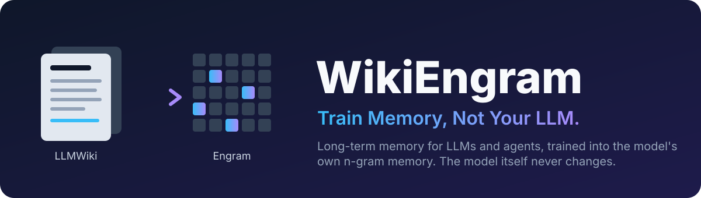

<div align="center">



### Long-term memory for LLMs and AI agents, trained into the model's own memory, with the model frozen.

[](https://github.com/Zihao-Wu06/WikiEngram/actions/workflows/ci.yml)
[](LICENSE)


[Quick start](#quick-start) · [Results](#results) · [For agents (MCP)](#use-it-from-ai-agents) ·
[How it works](#how-it-works) · [Models](#supported-models) · [Docs](docs/)

</div>

---

**WikiEngram gives a language model a memory it can actually learn into.** Your documents, conversations,
decisions and an agent's experience go into a versioned, human-readable wiki. The facts that matter most are
then *consolidated* into a small personal delta over the model's [Engram](https://github.com/deepseek-ai/Engram)
memory, the hashed n-gram table that Engram-family MoE models such as **Qwen3.8-Flash-Next** carry. The model's own
weights are never touched.

After that, the model answers from memory with **nothing retrieved into the prompt**. Edit or delete a fact in
the wiki and its memory rows are removed exactly. Anything not yet learned is still answered from the wiki,
so knowledge is never stale.

> On a real project's documentation, Qwen3.8-Flash-Next answered **99.3%** of trained questions from its
> trained memory alone, with no context. Combined with the wiki it matched retrieval-only accuracy with
> **30% fewer prompt tokens**. General-text perplexity moved by **+0.25%**. All of it was trained and measured
> on **one RTX 5090** with the 173 GB model streamed from disk. [Details below.](#results)

## Why WikiEngram?

Today an LLM remembers things in one of two ways. Both have a catch:

| | RAG / retrieval | Fine-tuning / LoRA | **WikiEngram** |
|---|:---:|:---:|:---:|
| Where knowledge lives | in the prompt, every query | in the model's weights | in a sparse delta over the model's Engram table, plus a wiki |
| Model weights changed | no | yes | **no** (checksum-verified) |
| Context per answer for learned facts | grows with what is retrieved | none | **none** |
| Correct or delete one fact | instant | retrain; no exact deletion | **instant in the wiki; exact row removal in memory** |
| Human-readable, auditable | yes | no | **yes** (versioned wiki pages) |
| Works with any LLM | yes | per model | **yes** for the wiki (MCP / API); neural memory on Engram-family models |

WikiEngram keeps both memories, the way people do. A fast, explicit memory (the **LLMWiki**) takes in
everything. Stable, important, frequently used knowledge is then consolidated into a slow, implicit memory
(**Engram**) that answers without being looked up.

## Highlights

- 🧠 **Neural memory without fine-tuning.** Only sparse rows of a personal delta are trained, with lazy Adam
  and a frozen backbone. The backbone, base table and fusion layers are checked byte-for-byte before and after
  every run.
- ✂️ **Exact forgetting.** A ledger records which rows each fact wrote. Deleting or correcting a fact removes
  its rows, so they read the frozen base table again, bit for bit. Facts that shared rows are retrained, and
  probes verify the old answer is gone.
- 📚 **LLMWiki.** Facts, preferences, decisions, lessons and notes, extracted by rules or any
  OpenAI-compatible LLM. Reconciled, versioned, scoped per project, rendered as Markdown pages.
- 🔀 **Hybrid answering.** Each question goes to Engram when Engram has verifiably learned the fact, and to the
  wiki otherwise. Pending edits apply before every answer.
- 🤖 **Made for agents.** An MCP server with memory tools, an OpenAI-compatible model API (streaming, tool
  calls), REST and a Python SDK.
- 🚀 **Big models on one GPU.** Qwen3.8-Flash-Next (about 180B MoE) runs and trains straight from its 173 GB FP8
  release on a 32 GB card. Experts are streamed from NVMe with `O_DIRECT`, the backward pass is recomputed layer
  by layer, and the flash-linear-attention kernels are used when installed.
- 🧪 **Faithful by construction.** The DeepSeek-V4.1 and Qwen3.8 Engram variants are bit-exact against their
  reference code. Every number in this README comes from a real run, with raw data in the repo.

## Results

**A real project, a real large model, one GPU.** The finished example ([`examples/strata/`](examples/strata/))
turns the documentation of [Strata](https://github.com/Niko1221/Strata) (MIT), an open-source engine that runs
large MoE models on consumer PCs, into memory for **Qwen3.8-Flash-Next**:

1. A local Qwen3-4B extracted 326 claims from 8 documents.
2. A review against the documents kept **149 facts** ([`review.json`](examples/strata/review.json) records every
   decision).
3. Each fact got 5–6 phrasings: 4 are trained, and 1 is held out and never trained.
4. The facts were consolidated on one RTX 5090 (32 GB), with the model streamed from NVMe in 92 GB of RAM.

| Answered by | Trained phrasing | Held-out phrasing | Prompt tokens |
|---|:---:|:---:|:---:|
| Qwen3.8-Flash-Next as shipped | 4.0% | 5.4% | 35 |
| **Engram only**, no context | **99.3%** | 42.3% | **35** |
| **Engram only**, as a plain chat message | **99.3%** | 34.9% | **30** |
| LLMWiki only (top-5 facts in the prompt) | 90.6% | 89.3% | 174 |
| **LLMWiki + Engram** | **91.9%** | **91.3%** | **121** |

- **Engram recalls what it was taught with no context at all:** 148 of 149 facts. That is significantly above
  retrieval (13 facts only Engram got right, none the other way).
- **New wordings are Engram's weak spot** (35–42%), and a miss can be off-topic. So the hybrid gives Engram
  only the 59 facts it has verifiably learned and sends the rest to the wiki.
- **The hybrid matches retrieval with 30% fewer prompt tokens.** Its small lead (+1.3 and +2.0 points) is
  within noise: 2 vs 0 and 6 vs 3 questions only one side got right, p ≈ 0.5. On trained wordings Engram alone
  stays ahead.

**Edits and deletions, on the same model.** 15 facts were corrected and 10 deleted in the wiki, then `sync`
ran ([`update_test.py`](examples/strata/update_test.py)):

| After the changes and `sync` | LLMWiki only | Engram only | LLMWiki + Engram |
|---|:---:|:---:|:---:|
| Corrected facts answered with the new value | 93.3% | 0% (not retrained yet) | 93.3% |
| Old value still produced (lower is better) | – | **0%** | **0%** |
| Deleted facts still produced (lower is better) | – | 20% | 10% |
| Untouched facts still answered | – | **100%** | 93.6% |
| After re-consolidating: new value / untouched | – | **100% / 99.2%** | – |

Neither deleted fact that was still produced came from the memory. Qwen3.8 as shipped already answers "MIT
License" to that question, and the other "hit" is a generic sentence containing the answer's words.

<details>
<summary><b>Cost, side effects and the agent demo</b></summary>

| | |
|---|---|
| Consolidating 149 facts | 25 epochs, 2 h 6 min on one RTX 5090; peak 28.8 GiB of GPU memory, 33.8 GiB of RAM |
| Personal memory | 93,339 delta rows (14.9 M parameters), a 61 MB file |
| General text | wikitext-2 perplexity 12.43 without the memory, 12.46 with it |
| Frozen | resident weights and fusion layers checksum-identical; experts and the n-gram table only read from the release files |
| Syncing 25 changes | 2 h 16 min, mostly retraining 28 facts that shared rows; re-consolidation 1 h 18 min |

**Through the model API.** Eight new questions were sent as plain chat messages. Qwen3.8 as shipped answered
none and invented `localhost:8080`, `strata status` and `speed_test`. With its memory and nothing in the prompt
it answered 4: `SSD`, `STRATA_KV_PREFETCH=1` and `strata_benchmark` as the whole reply in 5–9 s, and "580 or
newer" in a sentence.

**As an agent.** Asked to plan running Qwen3.8-Flash-Next on a 16 GB card, the model called the MCP tools
`memory_context` and then `memory_recall` (three times). It recorded the decision with `memory_record_decision`
and answered from what it recalled. The answer was cut at 256 tokens and isn't flawless. Full exchange:
[transcript](examples/strata/results/transcript.md). Raw data: [`examples/strata/results/`](examples/strata/results/).

</details>

<details>
<summary><b>Synthetic benchmarks: Qwen3-0.6B / 1.7B, 50–1,000 facts (Apple M4 and RTX 5090)</b></summary>

The facts are fictitious (invented names, companies, towns), so the base model cannot know them. Held-out
paraphrases are never trained or used for verification. These runs use the *retrofit* backend: a frozen
Hugging Face decoder with an Engram attached. Their hybrid numbers were measured with the earlier routing,
which kept other facts about the same subject in the prompt when a question went to Engram.

<!-- BENCHMARK:START -->
Measured on an **Apple M4 (32 GB, MPS)** with **Qwen3-0.6B-Base**, 50 fictitious facts, single run (seed 0).
The base Engram was trained once for 300 steps on WikiText-2 with the backbone frozen; held-out perplexity
went from 27.5 to 23.4.

| Memory | Trained question | Held-out paraphrase | Prompt tokens / query | Time to first token | Total (batch 1) |
|---|---|---|---|---|---|
| Backbone only (no memory) | 0% | 0% | 18 | 46 ms | 408 ms |
| LLMWiki only | 100% | 98% | 87 | 88 ms | 211 ms |
| Engram only | 96% | 56% | 18 | 52 ms | 166 ms |
| **LLMWiki + Engram** | 100% | 94% | 62 | 54 ms | 194 ms |

| After correcting 10 facts and deleting 5 in the wiki, then `sync` | Engram only | LLMWiki + Engram |
|---|---|---|
| Corrected facts: new value answered | 0% (not consolidated yet) | 100% |
| Corrected facts: old value still produced (lower is better) | 0% | 0% |
| Deleted facts still produced (lower is better) | 0% | 0% |
| Untouched facts retained | 100% | 100% |
| After re-consolidating the corrected facts: new value / untouched retained | 100% / 100% | |

Consolidating 50 facts took 116 s on the M4; the personal delta is a 33 MB file. Raw data:
[`benchmarks/results/m4-qwen3-0.6b-50facts.json`](benchmarks/results/m4-qwen3-0.6b-50facts.json).
<!-- BENCHMARK:END -->

**Scaling on one RTX 5090** (learning rate 0.02, batch 16; the 50- and 200-fact rows are means over 3 seeds):

| Backbone, facts | Engram only: trained / held-out | LLMWiki only: held-out | LLMWiki + Engram: trained / held-out | Prompt tokens: LLMWiki / hybrid | Consolidation | Delta |
|---|---|---|---|---|---|---|
| Qwen3-0.6B, 50 | 98.7% / 46.7% | 94.0% | 99.3% / 89.3% | 88 / 71 | 25 s | 31 MB |
| Qwen3-1.7B, 200 | 99.2% / 39.8% | 96.0% | 99.5% / 88.7% | 87 / 70 | 170 s | 112 MB |
| Qwen3-1.7B, 500 | 99.0% / 42.8% | 91.6% | 99.6% / 87.0% | 88 / 71 | 425 s | 248 MB |
| Qwen3-1.7B, 1,000 | 98.6% / 43.4% | 95.2% | 99.7% / 86.8% | 89 / 68 | 845 s | 418 MB |

At 1,000 facts, 200 were corrected and 100 deleted, then `sync` ran. 99% of corrected facts were answered with
the new value, old values and deleted facts were never produced, and 99.9% of untouched facts were kept.
Raw data: [`benchmarks/results/`](benchmarks/results/). To reproduce:

```bash
wikiengram bench --facts 50 --model Qwen/Qwen3-0.6B-Base --out benchmark-results
```

</details>

## Quick start

```bash
git clone https://github.com/Zihao-Wu06/WikiEngram.git && cd WikiEngram
pip install -e ".[api,data,mcp]"                     # Python 3.10+, PyTorch 2.4+
```

On a laptop (CUDA, Apple MPS or CPU) with a small retrofit model:

```bash
wikiengram init --model Qwen/Qwen3-0.6B-Base
wikiengram adapt --steps 300                          # once per backbone: train the base Engram, backbone frozen
wikiengram ingest examples/data/team_notes.md         # documents, chats (--kind conversation), notes
wikiengram consolidate                                # train the selected facts into the personal memory
wikiengram ask --mode hybrid "Where does Ilsa Varrow work?"
```

Correct a fact. Memory forgets the old value, and the wiki answers the new one right away:

```bash
wikiengram wiki correct <claim-id> --object "Northgate Systems"
wikiengram sync
```

Or from Python ([`examples/python_api.py`](examples/python_api.py)):

```python
from wikiengram.config import WorkspaceConfig
from wikiengram.runtime import WikiEngram

cfg = WorkspaceConfig(name="demo")
cfg.backend.model = "Qwen/Qwen3-0.6B-Base"
cfg.consolidation.min_score = 0.0                     # demo: consolidate everything now
ws = WikiEngram.init("wikiengram-data", cfg)
ws.adapt(steps=300)                                   # once per backbone
ws.wiki.ingest_file("examples/data/team_notes.md")
ws.consolidate()
print(ws.ask("Where does Ilsa Varrow work?", mode="hybrid").text)
```

The HTTP API is `wikiengram serve --port 8765` (OpenAPI docs at `/docs`), and `docker compose up --build`
runs the CUDA image. For a native Engram model such as
[Qwen3.8-Flash-Next-FP8](https://huggingface.co/Qwen/Qwen3.8-Flash-Next-FP8), follow the
[Strata example's setup](examples/strata/README.md#reproduce) ([hardware](#hardware)).

| Memory mode | What answers |
|---|---|
| `none` | the frozen model alone |
| `wiki` | LLMWiki only: retrieved facts in the prompt (BM25 + entity match) |
| `engram` | neural memory only: base Engram + personal delta, no context |
| `hybrid` | per question: Engram if it verifiably holds the most relevant fact at its current version (with nothing else in the prompt), otherwise the wiki with the delta off |

## Use it from AI agents

Two servers share one workspace:

| | Command | What the agent gets |
|---|---|---|
| **LLMWiki as MCP** | `wikiengram mcp -w ~/.wikiengram` | Memory tools. No model is loaded, so it runs next to any LLM, on any machine. |
| **The trained model as an API** | `wikiengram serve-model -w ~/.wikiengram --port 8000` | OpenAI-compatible `/v1/chat/completions` (streaming, tool calls) answering with its personal memory |

Add the memory to Claude Code, Cursor, Claude Desktop or any MCP client:

```bash
claude mcp add wikiengram -- wikiengram mcp -w ~/.wikiengram --scope my-project
```

```json
{"mcpServers": {"wikiengram": {"command": "wikiengram", "args": ["mcp", "-w", "/home/me/.wikiengram"]}}}
```

Talk to the trained model from any OpenAI client or agent framework:

```python
from openai import OpenAI

client = OpenAI(base_url="http://localhost:8000/v1", api_key="unused")
reply = client.chat.completions.create(
    model="wikiengram",
    messages=[{"role": "user", "content": "Which database did we pick, and why?"}],
    extra_body={"memory": "hybrid"},  # engram (default) | hybrid | none
)
```

Or use the memory in-process:

```python
from wikiengram.agent import Memory

mem = Memory("~/.wikiengram", scope="my-project")
mem.set_preference("reply language", "Chinese", scope="")          # global
mem.record_decision("database", "SQLite", "single user, zero setup")
mem.record_experience("deploying", "warm the page cache before benchmarking")
print(mem.context("migrate the database"))                          # a brief for the agent's prompt
```

<details>
<summary><b>All memory tools</b> (the same definitions over MCP, REST, OpenAI function calling and the SDK)</summary>

| Tool | Use |
|---|---|
| `memory_context` | Brief before a task: preferences, project context, past decisions and lessons relevant to it |
| `memory_recall` | Memories relevant to a query, plus a context block ready for the prompt |
| `memory_remember`, `memory_add_fact` | Store facts (free text is extracted and reconciled; a newer value supersedes the old one) |
| `memory_set_preference` | User preferences, e.g. reply language |
| `memory_record_decision` | Decisions and their reasons; revisiting a topic keeps the earlier ones in the history |
| `memory_record_experience` | Lessons from a task: what worked, what failed |
| `memory_observe_conversation` | Extract facts from a chat |
| `memory_correct`, `memory_forget`, `memory_history` | Fix, retract (reversible) or purge a memory; see every version |
| `memory_status` | Counts by kind and project, neural-memory readiness |

Memories have a kind (fact, preference, decision, experience, project, note) and a scope (a project, or
global). Whatever an agent writes is consolidated by the model server, on demand
(`POST /v1/memory/consolidate`) or in the background (`--auto-consolidate-minutes 30`). Edits and deletions
take effect on the next answer. Reading and writing memory never needs a GPU. Agents on any other LLM use the
same tools: `wikiengram.agent.openai_tools()` returns the definitions, and `dispatch(mem, name, arguments)` runs
a call.

</details>

## How it works


- **Sparse by construction.** Engram rows are addressed by hashed token n-grams, so the rows a fact touches are
  known before the forward pass. Training updates only those rows, and the cost doesn't depend on table size.
- **Automatic consolidation.** A policy scores facts on importance, use, stability and confidence. Each fact is
  trained with several phrasings (also as plain chat messages for chat models) and verified with probes,
  including one held-out phrasing.
- **Exact, verified forgetting.** Deleting a fact removes its exclusive rows and resets shared ones. Survivors
  whose probes fail are retrained, and forget-probes confirm the old answer is gone.
- **Dual-memory inference.** A question goes to Engram only when Engram verifiably holds the fact. The personal
  delta never acts on wiki context, and pending edits are applied before every answer.

More: [architecture](docs/ARCHITECTURE.md), [design decisions](docs/DESIGN.md), [native MoE backends](docs/NATIVE_MOE.md).

## Supported models

| Model | Engram variant | Status |
|---|---|---|
| **Qwen3.8-Flash-Next** (MoE, native "PLE" n-gram memory) | `qwen-ple` | ✅ runs and trains from the FP8 release on one 32 GB GPU; hashing and fusion bit-exact vs transformers; [measured](#results) |
| **DeepSeek-V4.1-Flash** / -1017 (MoE, native Engram) | `deepseek-v4.1` | ✅ hashing, layout, compression, fusion bit-exact vs the official code; FP8 table reader. 🚧 native backbone (no trainable implementation exists yet) |
| Any Hugging Face decoder (Qwen3, Llama-style, SmolLM2, ...) | either, attached as a retrofit | ✅ full pipeline: adapt, consolidate, sync, ask, benchmark |
| Any other LLM | – | ✅ wiki memory through MCP, REST, SDK or function calling |

New Engram families plug in by implementing one `EngramVariant` with parity tests
([`variant.py`](src/wikiengram/engram/variant.py)). Meituan's LongCat uses a different design (n-gram
embeddings at the input, no gated Engram) and is not supported.

## Hardware

| Task | Apple M4, 32 GB | One RTX 5090, 32 GB |
|---|---|---|
| Retrofit Qwen3-0.6B / 1.7B: adapt, consolidate, ask | ✅ measured | ✅ measured up to 1,000 facts |
| Qwen3.8-Flash-Next, native (173 GB FP8) | ✗ too large | ✅ measured; streamed from NVMe with 92 GB of RAM |
| DeepSeek-V4.1-Flash, native | ✗ | 🚧 planned |

Models larger than the GPU run through accelerate placement, plus a layer-by-layer recompute backward whose
gradients equal ordinary back-propagation. This works on CUDA, ROCm, Intel XPU, Apple MPS and CPU. For
Qwen3.8-Flash-Next, install `pip install "fla-core>=0.5"`: without it, the DeltaNet layers fall back to a
PyTorch implementation that is much slower and needs about 3× the memory.

## Limitations

- **Unseen wordings.** Engram memory is keyed on surface n-grams, so it recalls trained wordings far better than
  new ones (35–56% held-out). The hybrid mode exists for this.
- **Backbone knowledge can't be deleted.** Removing delta rows can't erase what the frozen model already knows.
  The wiki overrides it at answer time.
- **Slow on disk-streamed models.** On Qwen3.8-Flash-Next every training step and every batched generation step
  reads most of its 121 GB of experts. 149 facts took two hours to consolidate, and syncing 25 changes took over
  two hours.
- **Evidence so far.** One real project (149 facts) on the native model, plus synthetic facts at up to 1,000 on
  small models. Comparisons with LoRA, dense retrieval and agent-memory benchmarks are still to come.

## Roadmap

- [x] DeepSeek-V4.1 and Qwen3.8 Engram variants, bit-exact
- [x] Personal delta with exact deletion, sync and verification
- [x] Qwen3.8-Flash-Next native backend on one GPU
- [x] MCP server, OpenAI-compatible model API, SDK
- [ ] Early stopping for sync repair (it runs to the epoch cap when the loss plateaus)
- [ ] Faster batched decoding on streamed models (drop finished sequences)
- [ ] Dense retrieval option for the LLMWiki
- [ ] LoRA and long-term agent memory benchmarks
- [ ] DeepSeek-V4.1-Flash native backend
- [ ] Published trained example memory

## Contributing

Contributions are welcome: new Engram families, retrieval backends, benchmarks, agent integrations. The rules
that keep the project trustworthy are in [CONTRIBUTING.md](CONTRIBUTING.md): no simulated results, Engram
parity stays bit-exact, and the backbone stays frozen.

```bash
pip install -e ".[dev,api,data]" && pytest -q        # tiny random models, no downloads
```

<details>
<summary><b>Project layout</b></summary>

```
src/wikiengram/
  engram/          variant interface + registry; DeepSeek and Qwen PLE variants; tables (incl. FP8),
                   personal delta, row-sparse optimizer, stage-1 adapt
  backends/        hf.py: frozen decoder + Engram hooks, KV-cached generation
                   native.py, checkpoint.py, streaming.py: native MoE from its checkpoint, streamed backward
  agent/           Memory API for agents, the shared memory tools, the MCP server
  api/             REST API (server.py) and the OpenAI-compatible model API (openai_server.py)
  wiki/            LLMWiki: extraction, reconciliation, claim store, BM25 retrieval, pages
  consolidation/   policy, samples, delta trainer, row ledger, verification
  sync/            propagate wiki edits and deletions into memory (forget, repair, verify)
  fusion/          dual-memory inference
  runtime.py, cli.py
examples/strata/   a real project's memory: build, evaluate, update test, agent demo, results
benchmarks/        raw benchmark results
tests/             parity tests against reference code, unit and end-to-end tests
```

</details>

## Citation

```bibtex
@software{wikiengram2026,
  title  = {WikiEngram: Train Memory, Not Your LLM},
  author = {Wu, Zihao},
  year   = {2026},
  url    = {https://github.com/Zihao-Wu06/WikiEngram}
}

@article{cheng2026engram,
  title   = {Conditional Memory via Scalable Lookup: A New Axis of Sparsity for Large Language Models},
  author  = {Cheng, Xin and Zeng, Wangding and Dai, Damai and others},
  journal = {arXiv preprint arXiv:2601.07372},
  year    = {2026}
}
```

## Acknowledgements

- DeepSeek-AI for Engram ([paper](https://arxiv.org/abs/2601.07372), [code](https://github.com/deepseek-ai/Engram),
  Apache-2.0) and [DeepSeek-V4.1-Flash](https://huggingface.co/deepseek-ai/DeepSeek-V4.1-Flash) (MIT), whose
  inference code the Engram port follows.
- Andrej Karpathy's [LLM Wiki](https://gist.github.com/karpathy/442a6bf555914893e9891c11519de94f) pattern.
- The Qwen team for [Qwen3.8-Flash-Next](https://huggingface.co/Qwen/Qwen3.8-Flash-Next) and Qwen3-4B-Instruct-2507,
  and [flash-linear-attention](https://github.com/fla-org/flash-linear-attention) for the DeltaNet kernels.
- [Strata](https://github.com/Niko1221/Strata) (MIT) for showing these models run on consumer hardware; its
  documentation is the knowledge in the [example memory](examples/strata/).

## License

Apache-2.0. See [LICENSE](LICENSE) and [NOTICE](NOTICE). Model weights carry their own licenses.

<div align="center">

**If WikiEngram is useful to you, a ⭐ helps others find it.**

[](https://star-history.com/#Zihao-Wu06/WikiEngram&Date)

</div>
