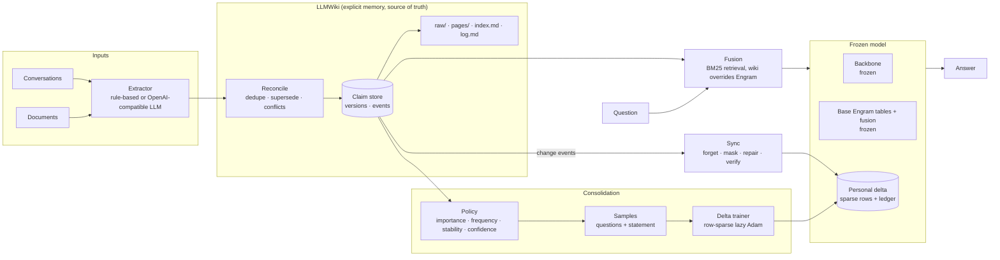

# Architecture

WikiEngram gives an Engram-equipped model two memories while the model itself stays frozen. It targets every
MoE model that carries an Engram-style conditional memory (hashed n-gram embedding tables fused into the
residual stream).

* **Explicit memory: LLMWiki.** Knowledge extracted from documents and conversations, kept as versioned,
  human-readable claims and markdown pages. It is the source of truth. Edits are instant and free.
* **Neural memory: a personal Engram delta.** Stable, important, frequently used claims are consolidated
  (trained) into a sparse delta over the model's Engram tables. It costs no context tokens at inference time.
* **The model stays frozen.** The backbone, the base Engram tables and the Engram fusion parameters never change
  after setup. Every training run (consolidation and repair) compares byte-exact checksums of all three before
  and after, and fails loudly if anything changed.
* **Model-agnostic core.** Personal memory, ledger, consolidation, sync, verification and fusion depend only on
  the small `EngramVariant` interface. Each Engram family (DeepSeek's first) implements it once.



## Engram variants (`src/wikiengram/engram/variant.py`)

An `EngramVariant` describes one family's module:

| Method or property | Meaning |
|---|---|
| `hash(input_ids, token_mask)` | `[B, L, n_layers, rows_per_position]` absolute table rows. A pure function of token ids, computed on the CPU before the forward pass |
| `n_groups`, `group_size` | the rows of one position come in `n_groups` groups of `group_size` rows; each group corresponds to one n-gram |
| `ngram_keys(input_ids)` | `[B, L, n_groups]` layer-independent n-gram fingerprints, used for statistics (generic n-grams) |
| `layer_ids`, `row_dim`, `num_rows`, `hidden_size`, `max_lookback` | geometry |
| `make_module(layer_id)` | the fusion module, `module(hidden, emb, token_mask) -> hidden`, applied before that block |
| `fingerprint()`, `to_dict()` / `from_dict()` | identity of the addressing scheme (a personal delta is only valid for the same one) and checkpoint serialization |
| `detect(config)`, `from_model_config(config)` | recognize and read a native checkpoint's configuration |

Variants register by name (`@register`). Checkpoints store the variant description, so a base Engram or a
personal delta always comes back with the right addressing. `tests/test_variants.py` runs the full
consolidate → recall → exact-delete cycle with a deliberately different toy family (different hashing, row
grouping and fusion) to keep the core honest.

Registered variants:

| Variant | Family | Parity tests |
|---|---|---|
| `deepseek-v4.1` | DeepSeek Engram (DeepSeek-V4.1-Flash) | `tests/test_engram_parity.py` vs DeepSeek's `inference/engram.py` + `Engram.forward` |
| `qwen-ple` | Qwen PLE (Qwen3.8-Flash-Next) | `tests/test_variant_parity.py` vs transformers `Qwen4ExpTextNGramEmbedding` + `Qwen4ExpTextPLELayer` (fp32 and bf16, bit-exact; streaming decode) |

Stateful fusion modules, such as Qwen's dilated conv that looks back 9 positions, implement
`begin_stream()` / `end_stream()`. Generation calls them so that decoding one token at a time matches the
full-sequence computation.

### DeepSeek variant (`deepseek-v4.1`)

The first variant ports DeepSeek-V4.1-Flash's production Engram (`inference/engram.py` and `Engram` in
`inference/model.py`, MIT). `tests/test_engram_parity.py` checks it bit for bit against a vendored copy of
that code:

| Piece | File | Parity test |
|---|---|---|
| Tokenizer compression: NFKC/NFD/strip accents/lowercase/whitespace, raw Rust decode | `compression.py` | identical lookup; reproduces V4.1's `engram_compressed_vocab_size = 99092` |
| Bucket layout: distinct primes per (layer, n-gram order, head); search restarts per order | `layout.py` | identical primes; V4.1 table sizes `384006168` / `384016682` |
| Hash multipliers: odd, `default_rng(10007 * layer_id)`, int64-safe bound | `layout.py` | identical |
| Rolling multiplicative-XOR n-gram hash; look-back blocked at sequence start and dead/padding tokens | `hashing.py` | identical ids, including masks |
| Fusion: fused `wkv` → per-copy key + shared value; RMS-normalized dot gate, signed sqrt, sigmoid; `h + gate·value` | `module.py` | identical outputs for `hc_mult` 1 and 4 |
| Native FP8 table rows (`F8_E4M3` with `F8_E8M0` per-32 scales), read lazily from safetensors | `tables.py` | matches DeepSeek's dequantization |

As in V4.1 there is no ShortConv. The module is applied to the residual stream *before* its decoder block.

### The effective table: base + personal delta

```
row(r) = base[r] + delta[r]          (delta stores only rows personal knowledge touched)
```

Rows are addressed by token ids alone. That has three useful consequences:

1. **Rows are known before the forward pass.** The rows a claim's training samples touch can be computed
   offline, without the model. The ledger (`consolidation/ledger.py`) records them.
2. **Training is row-sparse.** Each batch's unique rows become a gradient leaf ("gather to leaf"). Lazy Adam
   (`engram/optim.py`) keeps optimizer state only for touched rows and costs the same whatever the table size.
   This works on CUDA, MPS and CPU with dense ops only.
3. **Deletion is exact per row.** Removing a delta row makes it read the frozen base again, bit for bit
   (`tests/test_e2e_tiny.py::test_delete_restores_base_rows_exactly`). Rows written by several claims are
   reset and retrained for the survivors. Every training run records the rows it writes in the ledger,
   including repairs and rehearsals (`tests/test_regressions.py`).

The delta is a standalone `safetensors` file. It is tagged with the layout fingerprint, so it cannot be loaded
against a model whose rows are addressed differently.

## Backends

### Retrofit backends (`backends/hf.py`): runnable today

Models that ship Engram natively are large MoE models (DeepSeek-V4.1-Flash: 552B backbone + 196B Engram).
For laptops, CI and single GPUs, WikiEngram attaches an Engram variant (DeepSeek's by default) to a frozen
Hugging Face decoder (Qwen3 by default) through forward pre-hooks, so the backbone's code and weights are
untouched. The setup runs in two stages:

* **Stage 1, `wikiengram adapt` (once per backbone).** Base tables and fusion parameters are trained on
  general text with the language-modeling loss while the backbone is frozen. The value projection starts at
  zero, so the attached model starts as an exact copy of the backbone. After stage 1 everything is frozen.
  This plays the role of a native model's pretrained Engram.
* **Stage 2, `wikiengram consolidate` (whenever knowledge has stabilized).** Only the personal delta is
  trained.

### Native Engram MoE models: what exists and what does not

DeepSeek-V4.1-Flash is the first target; other families are tracked in [NATIVE_MOE.md](NATIVE_MOE.md).

| Capability | Status |
|---|---|
| Config parsing (`EngramSpec.from_deepseek_v41_config`) | implemented, tested |
| Bit-exact hashing, layout and compression vs the official code | implemented, tested |
| Reading native FP8 Engram rows from the official safetensors shards | implemented, tested on a synthetic shard with the official tensor names and dtypes |
| Personal delta format over V4.1 row addresses | implemented (layout-agnostic) |
| Trainable V4.1 backbone (MLA/sparse attention, mHC, MoE) for consolidation | **not implemented yet**: see `docs/NATIVE_MOE.md` |
| V4.1 inference with the delta (e.g. a patched Strata/llama.cpp Engram row reader) | **not implemented yet** |

We do not claim end-to-end support for any native model until it has been run on real hardware.

## Consolidation (`consolidation/`)

* **Policy** (`policy.py`): each claim gets a score that weights importance (pinned claims count as 1),
  usage frequency (`log1p` of access count), stability (age of the current version, discounted by the number
  of edits) and confidence. Hard filters are minimum confidence and a minimum version age. Claims whose
  current version is already consolidated are skipped.
* **Samples** (`samples.py`): a few question phrasings in QA format, plus the statement as a completion. One
  more phrasing is held out and used only to verify.
* **Trainer** (`trainer.py`): cross-entropy on answer tokens only. The optimizer is row-sparse Adam. Optional
  extras: blocked rows (n-grams that are very frequent in a background corpus, the analogue of Sparse Memory
  Finetuning's TF-IDF slot selection) and a KL locality term on general text.
* **Verification** (`verify.py`): Engram-only probes with no wiki context. A claim counts as *verified* only
  if every one of its probes is answered.

## Sync (`sync/engine.py`)

Every wiki change event (updated, retracted, restored, purged) that touches a consolidated claim is synced
in four steps:

1. **Forget.** Rows owned only by that claim are removed, which restores them exactly. Rows it shares with
   other claims are removed too, or only masked when `repair=False`. Masking is instant and needs no training.
2. **Check.** The surviving claims that lost rows are probed. Most lost only a row or two to a hash collision
   and still recall correctly ("lazy repair").
3. **Repair.** Survivors whose core probes now fail are retrained on the lost rows plus their own exclusive
   rows. Every row written is recorded in the ledger.
4. **Verify.** Engram alone must no longer produce the old answer. Every survivor's `verified` flag is
   recomputed from its full probe set. After an instant sync, survivors are marked unverified, and claims
   with masked rows are never trusted by hybrid routing until a full sync repairs them.

The new version of an edited claim is answered from the wiki immediately and consolidated later by the
policy. A purge also deletes the saved memory snapshots, because they still contain the claim. Before any
Engram or hybrid answer, pending events are synced in instant mode.

## Fusion (`fusion/engine.py`)

There are four modes: `none`, `wiki`, `engram` and `hybrid`. `hybrid` routes each question:

* If Engram verifiably recalls the most relevant retrieved claim at its current version, that claim is left
  out of the prompt and the personal delta answers. This is where the token savings come from.
* Otherwise the wiki answers and the delta is switched off. New, edited or unverified knowledge therefore
  always comes from the latest wiki state, and memory cannot compete with it.

On the Engram route, verified claims stay out of the prompt and only unverified claims about the same subject
are kept (unrelated facts in the prompt get copied as answers). On the wiki route the delta is off, so every
retrieved claim, verified or not, is in the prompt. The personal delta is applied only to the question tokens,
never to wiki context in the prompt. The base Engram applies everywhere.

Two measurements on Qwen3-0.6B (50 fictitious facts, held-out paraphrases) motivated this design:

| Setting | Accuracy |
|---|---|
| Wiki context, no delta | 91% |
| Wiki context + delta on every token | 49% |
| Wiki context + delta on the question only | 70% |

When a fact is in the context, memory can only interfere, hence the routing. Retrieval is lexical (BM25
plus subject match); there is no vector index.

## Limits

* N-gram memory is keyed on surface tokens. Paraphrases that share the entity's n-grams can be recalled;
  very different wordings may not. The benchmark reports held-out paraphrase accuracy separately for this
  reason.
* Facts that the frozen backbone (or the frozen base Engram) already knows cannot be removed by deleting delta
  rows. Only wiki precedence, or counter-training toward the new value, can override them.
* Retrofit Engram is not equivalent to Engram pretrained jointly with the backbone. Native MoE backends are a
  separate milestone.
